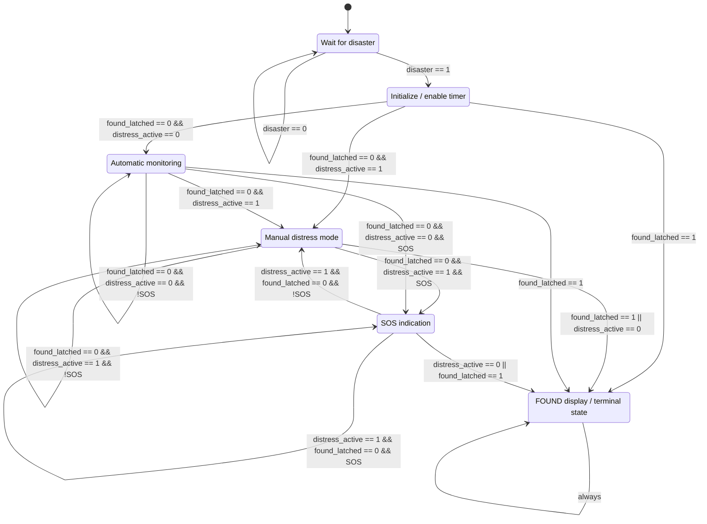

# FPGA Emergency Response System

A Verilog prototype for the DE10-Lite FPGA Emergency Response System. The design combines a disaster trigger, manual distress mode, pulse and movement inputs, an SOS indication, LEDs, and a timer display. Inputs such as `moving` and pulse level are supplied as digital signals; this repository does not include or demonstrate a complete physical sensor system.

## Project status

The repository currently contains one RTL source file, [`Verilog.v`](Verilog.v). The FSM, timer display, and LED signaling are implemented in that file. The repository does not currently include a Quartus project, pin assignments, a testbench, simulation waveforms, or a hardware demonstration. The code has not been presented here as verified on the DE10-Lite.

Some declared inputs and outputs are not used or driven by the current RTL. In particular, `light_level` and `KEY[1]` are unused, `ARDUINO_SOS` is declared but never assigned, and `LEDR[6:3]` are not assigned. See the I/O table and limitations below before connecting external hardware.

## Operating sequence

1. In `S0_IDLE`, the system waits for `SW[0]` (`disaster`) to go high.
2. The FSM advances to `S1_START`, then selects manual distress mode (`S2_BUTTONPRESS`) if `distress_active` is set; otherwise it enters automatic monitoring (`S3_AUTO_MON`).
3. A press on active-low `KEY[0]` (a falling edge on the pin) toggles `distress_active` while `time_en` is high. In `S3_AUTO_MON`, a press selects `S2_BUTTONPRESS`. In `S2_BUTTONPRESS`, a press that clears `distress_active` sends the FSM to `S5_RESET`.
4. In `S2_BUTTONPRESS` and `S3_AUTO_MON`, the `SOS` condition is true when there is no pulse (`SW[2:1] == 2'b10`), when the emergent pulse setting (`2'b01`) persists for the faint-pulse timer threshold, or when `moving` remains low for its timer threshold. This sends the FSM to `S4_SOS`.
5. `SW[3]` (`found`) is latched while the disaster switch is on. In active states, the latch sends the FSM to `S5_RESET`. `S5_RESET` displays `FOUND` and holds there; the RTL has no reset input or transition out of this state. The `found_latched` flag clears when `SW[0]` goes low, but the FSM remains in `S5_RESET` until the FPGA is reinitialized.

### FSM states and transitions

The diagram reflects the current RTL transition conditions. `SOS` is the wire defined in `Verilog.v`; the thresholds are 10 seconds for emergent pulse and 60 seconds without movement, measured by the 1 Hz timer logic.

| Port / signal | Direction | Current use |
| --- | --- | --- |
| `MAX10_CLK1_50` | Input | 50 MHz clock used for FSM and timer logic. |
| `SW[0]` (`disaster`) | Input | Starts the FSM from `S0_IDLE`; low clears `found_latched`. |
| `SW[2:1]` (`pulse`) | Input | `00` normal, `01` emergent/faint, `10` no pulse; `11` has no special handling. |
| `SW[3]` (`found`) | Input | Sets `found_latched` while disaster is active. |
| `KEY[0]` | Input | Active-low manual distress button; a press (falling edge on the pin) toggles `distress_active` while the timer is enabled. |
| `KEY[1]` | Input | Unused in current RTL. |
| `moving` | Input | High means movement detected; sustained low contributes to the SOS condition. |
| `light_level[1:0]` | Input | Declared as an Arduino input but unused in current RTL. |
| `LEDR[9]` | Output | `system_on` state indication. |
| `LEDR[0]` | Output | Green alert flag. |
| `LEDR[8]` | Output | Yellow/manual-distress alert flag. |
| `LEDR[7]` | Output | Red/SOS alert flag. |
| `LEDR[2:1]` | Output | Show `SW[2:1]` outside SOS; show the SOS blink signal in `S4_SOS`. |
| `LEDR[6:3]` | Output | Not assigned in current RTL. |
| `alert_level[1:0]` | Output | `00` normal, `01` warning, `10` SOS. |
| `HEX[5:0]` | Output | Displays elapsed `hh:mm:ss`; shows `SOS` briefly in `S2_BUTTONPRESS` and `FOUND` in `S5_RESET`. |
| `ARDUINO_LED` | Output | Follows `SW[1]` outside SOS and the SOS blink signal in `S4_SOS`; no light-sensor behavior is implemented. |
| `ARDUINO_SOS` | Output | Declared but not assigned in current RTL. |
